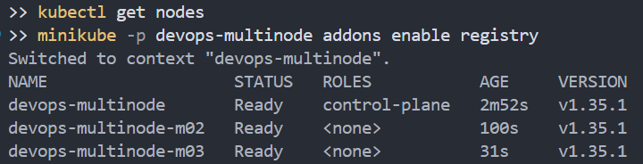
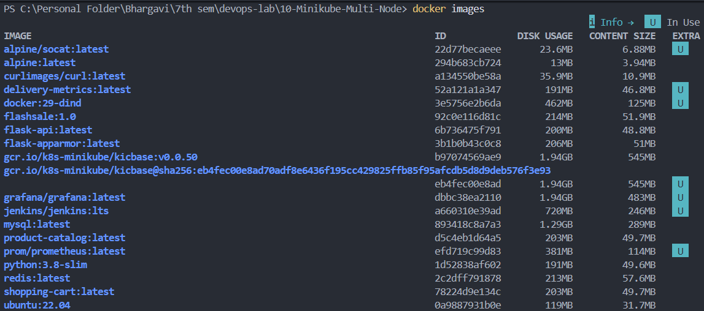
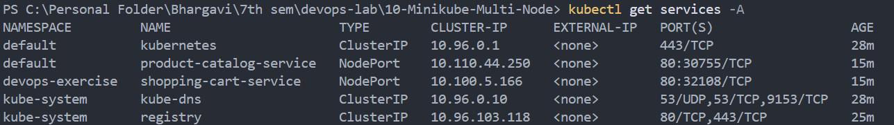
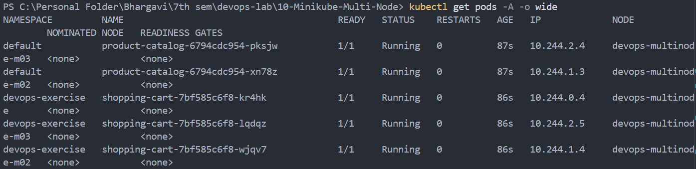
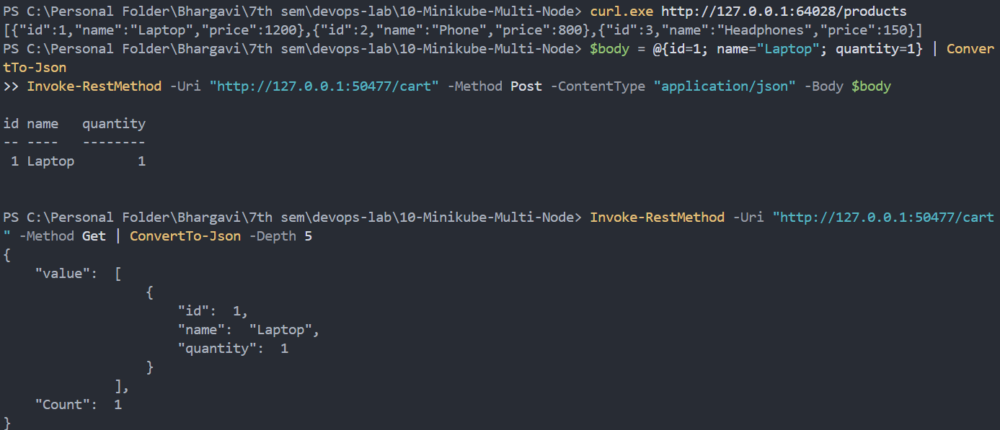

# Multi-Node Kubernetes Cluster with Multiple Applications and ReplicaSets

## Storyboard
This exercise deploys an e-commerce application consisting of two Flask services:

1. **Product Catalog (AppA)** – Provides information about available products.
2. **Shopping Cart (AppB)** – Allows users to view their cart and add items.

The Product Catalog runs with 2 replicas, while the Shopping Cart runs with 3 replicas. Kubernetes pod anti-affinity is used to distribute the replicas across the three-node Minikube cluster.

## Use Case
An online store needs availability and fault tolerance for services such as product browsing and cart management. Running multiple replicas across different nodes helps maintain service availability if a node becomes unavailable.

## Step 0: Clean up any existing Minikube cluster
Stop and delete the previous default Minikube cluster before creating the new cluster.

```powershell
minikube stop
minikube delete
```

## Step 1a: Set Up Minikube with Multiple Nodes
Create a three-node Minikube cluster named `devops-multinode`.

```powershell
minikube start --nodes 3 -p devops-multinode --force
kubectl config use-context devops-multinode
kubectl get nodes
```

The cluster contains three nodes:

- `devops-multinode`
- `devops-multinode-m02`
- `devops-multinode-m03`

All three nodes were verified to be in the `Ready` state.

## Step 1b: Enable the Registry Add-on
Enable the Minikube registry add-on for the multi-node profile.

```powershell
minikube -p devops-multinode addons enable registry
```

The registry add-on was enabled successfully. The Docker images were subsequently loaded into the Minikube cluster using `minikube image load`.



## Step 2: Product Catalog (AppA) – Python Code
Create `product_catalog.py`.

```python
from flask import Flask, jsonify

app = Flask(__name__)

products = [
    {"id": 1, "name": "Laptop", "price": 1200},
    {"id": 2, "name": "Phone", "price": 800},
    {"id": 3, "name": "Headphones", "price": 150},
]

@app.route("/products", methods=["GET"])
def get_products():
    return jsonify(products)

if __name__ == "__main__":
    app.run(host="0.0.0.0", port=80)
```

The `/products` endpoint returns a JSON list of available products.

## Step 3: Shopping Cart (AppB) – Python Code
Create `shopping_cart.py`.

```python
from flask import Flask, jsonify, request

app = Flask(__name__)
cart = []

@app.route("/cart", methods=["GET"])
def get_cart():
    return jsonify(cart)

@app.route("/cart", methods=["POST"])
def add_to_cart():
    item = request.json
    cart.append(item)
    return jsonify(cart), 201

if __name__ == "__main__":
    app.run(host="0.0.0.0", port=80)
```

The Shopping Cart provides two endpoints:

- `GET /cart` – Returns the current cart contents.
- `POST /cart` – Adds an item to the cart.

The cart uses in-memory storage; therefore, individual replicas do not share cart data.

## Step 4: Dockerize Applications
Create `Dockerfile.product` for the Product Catalog.

```dockerfile
FROM python:3.9-slim
WORKDIR /app
COPY product_catalog.py /app/
RUN pip install flask
CMD ["python", "product_catalog.py"]
```

Create `Dockerfile.shopping` for the Shopping Cart.

```dockerfile
FROM python:3.9-slim
WORKDIR /app
COPY shopping_cart.py /app/
RUN pip install flask
CMD ["python", "shopping_cart.py"]
```

Build both Docker images.

```powershell
docker build -t product-catalog:latest -f Dockerfile.product .
docker build -t shopping-cart:latest -f Dockerfile.shopping .
docker images
```

The following images were built successfully:

- `product-catalog:latest`
- `shopping-cart:latest`

## Step 5: Load Images into Minikube
Load both images into the Minikube cluster.

```powershell
minikube -p devops-multinode image load product-catalog:latest
minikube -p devops-multinode image load shopping-cart:latest
```

Verify that the images are available inside Minikube.

```powershell
minikube -p devops-multinode ssh -- docker images
```

Both application images were loaded successfully.



## Step 6: Deploy Applications on Minikube

### Product Catalog Deployment – 2 Replicas
Create `product_catalog_deployment.yaml`.

```yaml
apiVersion: apps/v1
kind: Deployment
metadata:
  name: product-catalog
  namespace: default
spec:
  replicas: 2
  selector:
    matchLabels:
      app: product-catalog
  template:
    metadata:
      labels:
        app: product-catalog
    spec:
      affinity:
        podAntiAffinity:
          requiredDuringSchedulingIgnoredDuringExecution:
          - labelSelector:
              matchLabels:
                app: product-catalog
            topologyKey: kubernetes.io/hostname
      containers:
      - name: product-catalog-container
        image: product-catalog:latest
        imagePullPolicy: Never
        ports:
        - containerPort: 80
```

### Shopping Cart Deployment – 3 Replicas
Create `shopping_cart_deployment.yaml`.

```yaml
apiVersion: apps/v1
kind: Deployment
metadata:
  name: shopping-cart
  namespace: devops-exercise
spec:
  replicas: 3
  selector:
    matchLabels:
      app: shopping-cart
  template:
    metadata:
      labels:
        app: shopping-cart
    spec:
      affinity:
        podAntiAffinity:
          requiredDuringSchedulingIgnoredDuringExecution:
          - labelSelector:
              matchLabels:
                app: shopping-cart
            topologyKey: kubernetes.io/hostname
      containers:
      - name: shopping-cart-container
        image: shopping-cart:latest
        imagePullPolicy: Never
        ports:
        - containerPort: 80
```

The Shopping Cart Deployment uses the `devops-exercise` namespace. Create the namespace before applying the deployment.

```powershell
kubectl create namespace devops-exercise
kubectl apply -f product_catalog_deployment.yaml
kubectl apply -f shopping_cart_deployment.yaml
```

The `requiredDuringSchedulingIgnoredDuringExecution` pod anti-affinity rule prevents replicas of the same application from being scheduled on the same node.

## Step 7: Expose the Services

### Product Catalog Service
Create `product_catalog_service.yaml`.

```yaml
apiVersion: v1
kind: Service
metadata:
  name: product-catalog-service
  namespace: default
spec:
  selector:
    app: product-catalog
  ports:
  - protocol: TCP
    port: 80
    targetPort: 80
  type: NodePort
```

### Shopping Cart Service
Create `shopping_cart_service.yaml`.

```yaml
apiVersion: v1
kind: Service
metadata:
  name: shopping-cart-service
  namespace: devops-exercise
spec:
  selector:
    app: shopping-cart
  ports:
  - protocol: TCP
    port: 80
    targetPort: 80
  type: NodePort
```

Apply the Service configurations.

```powershell
kubectl apply -f product_catalog_service.yaml
kubectl apply -f shopping_cart_service.yaml
kubectl get services -A
```

Both applications were exposed using NodePort Services.



## Step 8: Verify Deployment and Distribution
Run the following commands to inspect the cluster and the application pods.

```powershell
kubectl get nodes
kubectl get pods -A -o wide
kubectl get deployments -A
kubectl get services -A
```

The five application pods were running successfully with `1/1` containers ready.

| Application | Required replicas | Observed distribution |
| --- | ---: | --- |
| Product Catalog | 2 | One pod on `devops-multinode-m02` and one on `devops-multinode-m03` |
| Shopping Cart | 3 | One pod each on `devops-multinode`, `devops-multinode-m02`, and `devops-multinode-m03` |

This verifies that the replicas of each application were distributed across separate nodes.



## Step 9: Access the Services
Use Minikube service forwarding to access the applications from Windows.

### Step 9a: Access Product Catalog
Run the following command:

```powershell
minikube -p devops-multinode service product-catalog-service
```

The command starts a tunnel and displays a local URL. During this execution, the URL was:

`http://127.0.0.1:64028`

Keep the terminal running while testing the service.

### Step 9b: Access Shopping Cart
The Shopping Cart Service is in the `devops-exercise` namespace, so specify the namespace when accessing it.

```powershell
minikube -p devops-multinode service shopping-cart-service -n devops-exercise
```

The command starts a tunnel and displays a local URL. During this execution, the URL was:

`http://127.0.0.1:50477`

Keep this terminal running as well.

The local tunnel ports may change when the services are started again. Use the URLs printed by Minikube in each execution.

## Step 10: Test the Applications

### Test Product Catalog Service
Retrieve the list of products.

```powershell
curl.exe http://127.0.0.1:64028/products
```

Expected response:

```json
[
  {"id": 1, "name": "Laptop", "price": 1200},
  {"id": 2, "name": "Phone", "price": 800},
  {"id": 3, "name": "Headphones", "price": 150}
]
```

The endpoint returned all three products successfully.

### Test Shopping Cart Service
**1. Retrieve the initial cart**

```powershell
Invoke-RestMethod -Uri "http://127.0.0.1:50477/cart" -Method Get
```

Expected response:

```json
[]
```

The initial cart was empty.

**2. Add an item to the cart**

PowerShell's `ConvertTo-Json` was used to format the request body correctly.

```powershell
$body = @{id=1; name="Laptop"; quantity=1} | ConvertTo-Json
Invoke-RestMethod -Uri "http://127.0.0.1:50477/cart" -Method Post -ContentType "application/json" -Body $body
```

The request succeeded and returned the added item.

**3. Retrieve the cart again**

```powershell
Invoke-RestMethod -Uri "http://127.0.0.1:50477/cart" -Method Get | ConvertTo-Json -Depth 5
```

Observed response:

```json
{
  "value": [
    {
      "id": 1,
      "name": "Laptop",
      "quantity": 1
    }
  ],
  "Count": 1
}
```

The response confirms that the cart contained one item.



## Summary
In this exercise, two Flask applications were deployed on a three-node Minikube cluster using Kubernetes Deployments and NodePort Services.

- The Product Catalog was deployed with 2 replicas.
- The Shopping Cart was deployed with 3 replicas.
- Pod anti-affinity distributed the replicas of each application across separate nodes.
- Both application images were built and loaded into Minikube.
- All five application pods reached the `Running` state.
- The Product Catalog endpoint was tested successfully.
- The Shopping Cart's GET and POST endpoints were tested successfully.

This exercise demonstrates multi-node Kubernetes deployment, replica management, pod anti-affinity, service exposure, and application testing.

**Note:** The Shopping Cart stores data in memory. Different replicas have separate cart contents, so this implementation does not provide shared or persistent cart storage.
