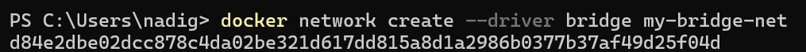
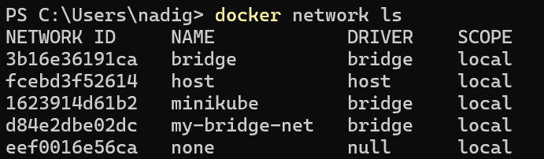
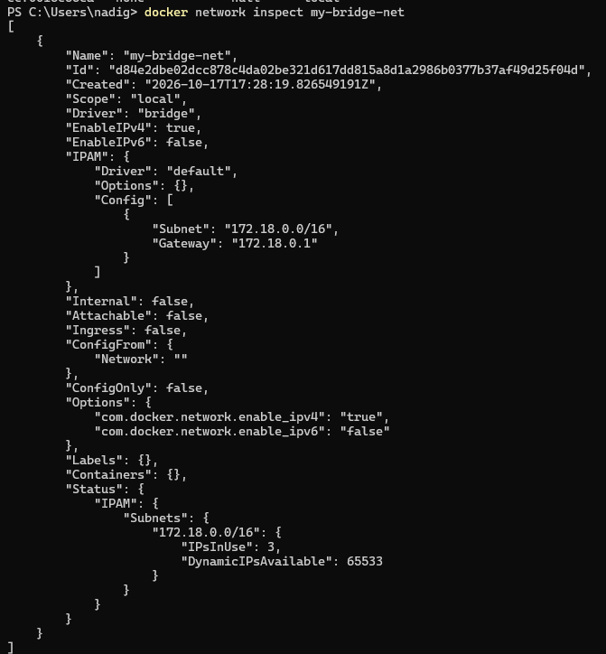
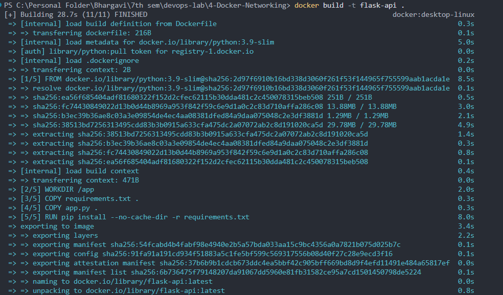
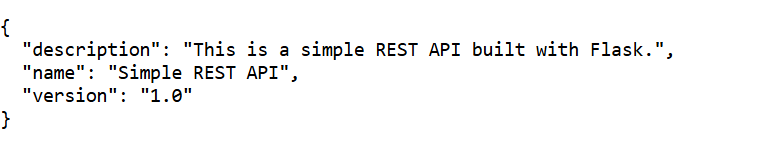
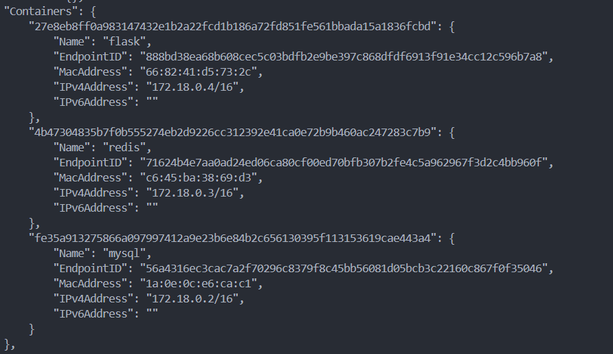
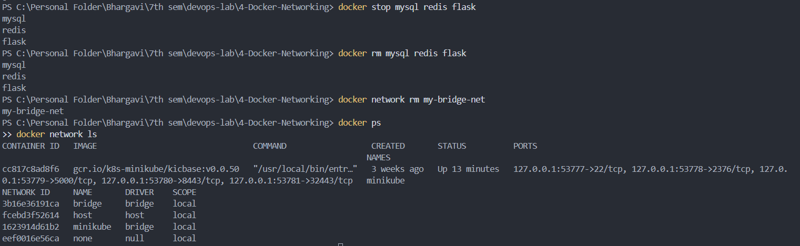

# Docker Networking with Multiple Containers

## Objective

To understand Docker networking concepts and configure a multi-container application using a custom bridge network.

## Scenario

The application consists of three Docker containers:

- **Flask:** Python-based web server exposing a REST API.
- **MySQL:** Relational database server.
- **Redis:** In-memory data store used for caching.

All three containers are connected to a custom Docker bridge network named `my-bridge-net`.

## Technologies Used

- Docker Desktop
- Docker Bridge Networking
- Python 3.9
- Flask 2.0.1
- MySQL
- Redis
- PowerShell

## Project Structure

```
4-Docker-Networking/
├── app.py
├── requirements.txt
├── Dockerfile
├── README.md
└── Screenshots/
    ├── 1.png
    ├── 2.png
    ├── 3.png
    ├── 4.png
    ├── 5.png
    ├── 6.png
    ├── 7.png
    ├── 8.png
    └── 9.png
```

## Implementation

### Task 1: Create a Bridge Network

Create a custom bridge network for communication between the containers.

```
docker network create --driver bridge my-bridge-net
```



### Task 2: Verify the Network

List all Docker networks and verify that `my-bridge-net` exists.

```
docker network ls
```



### Task 3: Inspect the Network

Inspect the network configuration, including its driver, subnet, gateway, and connected containers.

```
docker network inspect my-bridge-net
```

Initially, the network contains no containers.



### Task 4: Develop the Flask Application

Create `app.py`:

```
from flask import Flask, jsonify

app = Flask(__name__)

@app.route('/about', methods=['GET'])
def about():
    return jsonify({
        "name": "Simple REST API",
        "version": "1.0",
        "description": "This is a simple REST API built with Flask."
    })

if __name__ == '__main__':
    app.run(host='0.0.0.0', debug=False, port=5001)
```

The application exposes a GET endpoint at `/about` and returns information about the REST API in JSON format.

Create `requirements.txt`:

```
Flask==2.0.1
Werkzeug==2.0.3
```

Create the `Dockerfile`:

```
FROM python:3.9-slim

WORKDIR /app

COPY requirements.txt .
COPY app.py .

RUN pip install --no-cache-dir -r requirements.txt

EXPOSE 5001

CMD ["python", "app.py"]
```

The Dockerfile defines the base image, working directory, application files, dependencies, exposed port, and startup command.

### Task 5: Build the Flask Image

Build a Docker image named `flask-api`.

```
docker build -t flask-api .
```

Verify the image:

```
docker images
```


### Task 6: Launch the Containers

Start the MySQL container:

```
docker run -d --name mysql --network my-bridge-net -e MYSQL_ROOT_PASSWORD=LabPass123! mysql:latest
```

Start the Redis container:

```
docker run -d --name redis --network my-bridge-net redis:latest
```

Start the Flask container:

```
docker run -d --name flask --network my-bridge-net -p 5001:5001 flask-api
```

The `-d` option runs containers in the background, `--network` connects them to the custom bridge network, and `-p` publishes the Flask port to the host machine.

Verify that the containers are running:

```
docker ps
```



### Task 7: Test the Flask Application

Open the following URL in a browser:

`http://localhost:5001/about`

Expected response:

```
{
  "description": "This is a simple REST API built with Flask.",
  "name": "Simple REST API",
  "version": "1.0"
}
```



### Task 8: Test Container Connectivity

Enter the running Flask container:

```
docker exec -it flask sh
```

Resolve the MySQL container hostname:

```
python -c "import socket; print(socket.gethostbyname('mysql'))"
```

Observed output:

```
172.18.0.2
```

Resolve the Redis container hostname:

```
python -c "import socket; print(socket.gethostbyname('redis'))"
```

Observed output:

```
172.18.0.3
```

Exit the container:

```
exit
```

These tests demonstrate that Docker's internal DNS resolves the MySQL and Redis container names from the Flask container.


### Task 9: Inspect the Connected Containers

Inspect the network again:

```
docker network inspect my-bridge-net
```

The inspection showed all three containers connected to the network.

| Container | IPv4 address |
| --------- | ------------ |
| MySQL     | `172.18.0.2` |
| Redis     | `172.18.0.3` |
| Flask     | `172.18.0.4` |

The IP addresses are assigned by Docker and may differ if the exercise is repeated.



### Task 10: Clean Up

Stop the containers:

```
docker stop mysql redis flask
```

Remove the containers:

```
docker rm mysql redis flask
```

Remove the custom network:

```
docker network rm my-bridge-net
```

Verify the cleanup:

```
docker ps
docker network ls
```

The three lab containers and the custom network were successfully removed. The Flask image was retained.



## Results

- Created and inspected a custom Docker bridge network.
- Built a Flask Docker image successfully.
- Ran Flask, MySQL, and Redis containers on the same network.
- Accessed the Flask REST API through the published port.
- Verified Docker DNS hostname resolution for MySQL and Redis.
- Confirmed network membership using Docker network inspection.
- Successfully removed the lab containers and custom network.

**Note:** This exercise demonstrates networking and hostname resolution. The Flask application does not perform actual database queries or Redis cache operations.
