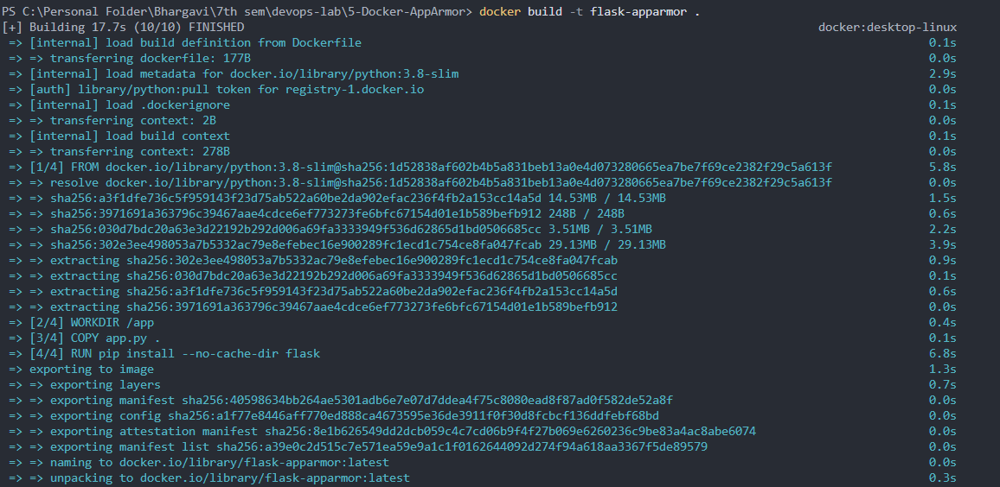
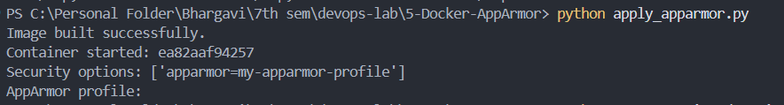
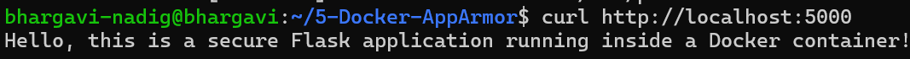
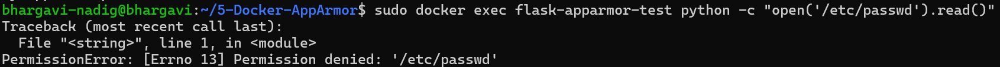
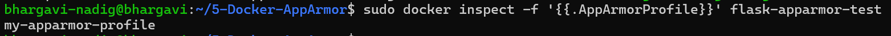

# Docker Security with AppArmor and Python

## 1. Objective

To containerize a Python Flask application with Docker, load a custom
AppArmor profile on Linux, attach it to a Docker container, and test
whether restricted actions are blocked.

This exercise was first attempted with Windows and Docker Desktop. Since
custom AppArmor enforcement was not available in that setup, the
exercise was continued in an Ubuntu Server virtual machine using
VirtualBox.

## 2. Tools and Environment

### Windows host

- Windows 11
- PowerShell
- Docker Desktop (used during the initial attempt)
- VirtualBox 7.2.x

### Ubuntu virtual machine

- Ubuntu Server 24.04.5 LTS
- 4 GB RAM, 2 CPUs, 30 GB virtual disk
- AppArmor enabled
- Docker Engine installed using Ubuntu packages
- Python 3.11-slim Docker image
- Docker SDK for Python (`python3-docker` package)

The Ubuntu VM was accessed from Windows using SSH through VirtualBox NAT
port forwarding:

- Host port: `2222`
- Guest port: `22`

Connect from Windows PowerShell with:

```
ssh -p 2222 bhargavi-nadig@localhost
```

## 3. Project Structure

```
5-Docker-AppArmor/
├── app.py
├── Dockerfile
├── requirements.txt
├── my-apparmor-profile
├── apply_apparmor.py
├── test_restricted_actions.py
├── README.md
└── screenshots/
```

## 4. Flask Application (`app.py`)

```
from flask import Flask

app = Flask(__name__)

@app.route('/')
def home():
    return "Hello, this is a secure Flask application running inside a Docker container!"

if __name__ == '__main__':
    app.run(host='0.0.0.0', port=5000)
```

The application returns a greeting at `/` and listens on port `5000` on
all container interfaces.

## 5. Dependencies (`requirements.txt`)

```
Flask
docker
```

Flask is installed in the container image. The Docker SDK package is
used by the Python automation scripts.

## 6. Dockerfile

The Dockerfile used in the final Ubuntu run is:

```
FROM python:3.11-slim

WORKDIR /app

COPY app.py .

RUN pip install --no-cache-dir flask

EXPOSE 5000

CMD ["python", "app.py"]
```

**Note:** The initial Dockerfile used `python:3.8-slim`. During the
Ubuntu run, Python reported that `libpython3.8.so.1.0` could not be
found. The base image was changed to `python:3.11-slim` and rebuilt. The
final image built successfully.

## 7. Initial Attempt on Windows

The image and Flask application were initially tested with Docker
Desktop on Windows. The Docker Desktop environment did not report a
custom AppArmor profile as active, and the restricted-action tests did
not demonstrate enforcement.

Because AppArmor is a Linux security module, the work was continued in a
dedicated Ubuntu Server VM rather than treating the Windows Docker
Desktop result as proof of enforcement.

These screenshots document the initial Windows attempt only; they do
not demonstrate custom AppArmor enforcement:






## 8. Set Up Ubuntu and Docker

After installing Ubuntu Server in VirtualBox, connect to the VM through
SSH and install Docker, AppArmor utilities, and the Python Docker SDK:

```
sudo apt update
sudo apt install -y docker.io docker-compose-v2 apparmor-utils python3-docker
```

Enable Docker and check AppArmor:

```
sudo systemctl enable --now docker
sudo aa-status
```

The `aa-status` output confirmed that the AppArmor module was loaded and
that profiles were present, including `docker-default`.

A `hello-world` image pull initially returned a Docker Hub
`500 Internal Server Error`. The later Flask base-image pull succeeded,
so work continued with the Flask image.

## 9. Transfer Project Files to Ubuntu

Create a project directory in Ubuntu:

```
mkdir -p ~/5-Docker-AppArmor
```

From a separate Windows PowerShell window, run:

```
scp -P 2222 -r "C:\Personal Folder\Bhargavi\7th sem\devops-lab\5-Docker-AppArmor\*" bhargavi-nadig@localhost:~/5-Docker-AppArmor/
```

Reconnect to Ubuntu and enter the directory:

```
cd ~/5-Docker-AppArmor
ls
```

## 10. AppArmor Profile (`my-apparmor-profile`)

The final profile used for the Linux test was:

```
#include <tunables/global>

profile my-apparmor-profile flags=(attach_disconnected,mediate_deleted) {
    #include <abstractions/base>

    /usr/local/lib/** mr,
    network inet stream,
    capability net_bind_service,
    deny capability sys_admin,

    deny /etc/passwd r,
    deny /bin/bash x,

    /app/** rwk,
}
```

The profile uses the name `my-apparmor-profile`, which matches the
profile name passed to Docker. The `/usr/local/lib/** mr,` rule allows
Python to read and memory-map its shared libraries; without this rule,
Python failed to start because AppArmor denied access to
`libpython3.11.so.1.0`.

Load or reload the profile:

```
sudo apparmor_parser -r my-apparmor-profile
```

A successful load returns to the shell prompt without a parser error.

## 11. Build the Docker Image

From the project directory, run:

```
sudo docker build --no-cache -t flask-apparmor .
```

The final build completed successfully and created the image
`flask-apparmor:latest`.

The Docker output displayed a legacy-builder deprecation notice. This
was a warning; it did not prevent the image from building.

## 12. Run the Container with AppArmor

Start the container:

```
sudo docker run -d --name flask-apparmor-test \
  --security-opt apparmor=my-apparmor-profile \
  -p 5000:5000 flask-apparmor
```

Inspect the profile attached to the container:

```
sudo docker inspect -f '{{.AppArmorProfile}}' flask-apparmor-test
```

Expected and observed output:

```
my-apparmor-profile
```

This confirms that Docker reports the custom profile name for the
running container.

## 13. Test the Flask Application

Run:

```
curl http://localhost:5000
```

Successful output:

```
Hello, this is a secure Flask application running inside a Docker container!
```

This confirms that the Flask application was reachable on port `5000`
while running with the custom AppArmor profile attached.



To check container logs:

```
sudo docker logs flask-apparmor-test
```

## 14. Test Restricted Actions

### Test 1: Read `/etc/passwd`

Run:

```
sudo docker exec flask-apparmor-test python -c "open('/etc/passwd').read()"
```

Observed result:

```
Traceback (most recent call last):
  ...
PermissionError: [Errno 13] Permission denied: '/etc/passwd'
```

**Result:** Reading `/etc/passwd` was denied. This is the confirmed
restriction demonstrated in the exercise.



### Test 2: Execute `/bin/bash`

Run:

```
sudo docker exec flask-apparmor-test /bin/bash -c "echo Shell executed"
```

Observed result:

```
Shell executed
```

**Result:** Shell execution was allowed. The attempted `/bin/bash`
denial did not block this command, so this restriction was not
successfully demonstrated.

Do not report the shell test as blocked. The confirmed results are that
the Flask application works, Docker reports the custom AppArmor profile,
and reading `/etc/passwd` is denied.

## 15. Useful Verification Commands

Check AppArmor status:

```
sudo aa-status
```

Check the profile attached to the container:

```
sudo docker inspect -f '{{.AppArmorProfile}}' flask-apparmor-test
```

Check the application response:

```
curl http://localhost:5000
```

Check container logs:

```
sudo docker logs flask-apparmor-test
```

Check recent AppArmor kernel messages:

```
sudo dmesg | grep -i apparmor | tail -10
```



## 16. Screenshots

The Ubuntu screenshots are mapped to the results they show:

1. **Flask response:** [screenshots/4.png](screenshots/4.png) shows
   `curl http://localhost:5000` returning the greeting.
2. **Profile attached:** [screenshots/5.png](screenshots/5.png) shows
   `docker inspect` returning `my-apparmor-profile`.

   ![Docker inspect showing the attached AppArmor profile]

3. **Restricted file access:** [screenshots/6.png](screenshots/6.png)
   shows the `/etc/passwd` test returning `PermissionError`.

Screenshots `1.png` through `3.png` are retained above as documentation
of the initial Windows attempt, not as evidence of AppArmor enforcement.
The current screenshots folder does not contain a screenshot of the
Ubuntu `aa-status` output or the successful final Ubuntu image build.

Keep screenshots that show successful and accurate results. Recommended
screenshots:

1. **AppArmor status:** `sudo aa-status` showing that AppArmor is
   loaded.
2. **Docker image build:** successful
   `sudo docker build --no-cache -t flask-apparmor .`.
3. **Flask response:** `curl http://localhost:5000` showing the
   greeting.
4. **Profile attached:**
   `sudo docker inspect -f '{{.AppArmorProfile}}' flask-apparmor-test`
   showing `my-apparmor-profile`.
5. **Restricted file access:** the `/etc/passwd` test showing
   `PermissionError`.

If including the shell test, label it accurately as **shell execution
still allowed**. Replace earlier screenshots that show failed app
startup or incorrect results.

## 17. Cleanup

To stop and remove the container when finished:

```
sudo docker rm -f flask-apparmor-test
```

To keep using the application, leave the container running and do not
run the cleanup command yet.

## 18. Result and Conclusion

The Flask application was containerized and built successfully in Ubuntu
Server. AppArmor was active on the Linux VM, the custom profile loaded,
and Docker reported `my-apparmor-profile` as the container's AppArmor
profile. The application responded successfully on port `5000`, and the
test confirmed that reading `/etc/passwd` was denied.

The attempted shell-execution restriction was not effective: `/bin/bash`
still executed. Therefore, the exercise demonstrates one confirmed
AppArmor restriction, but not every rule in the profile.
