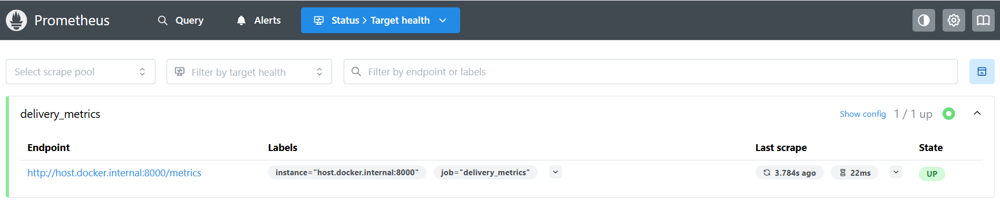
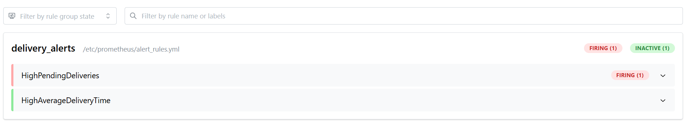
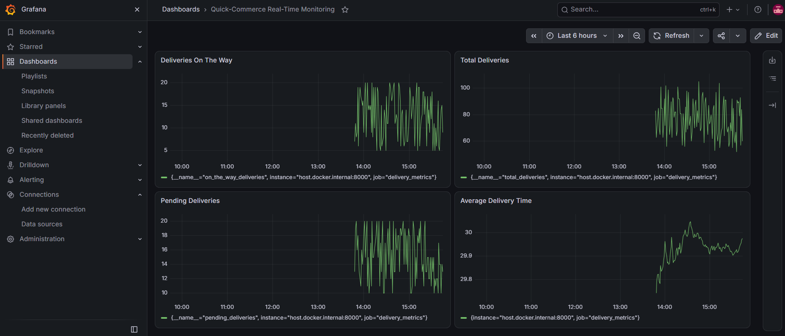
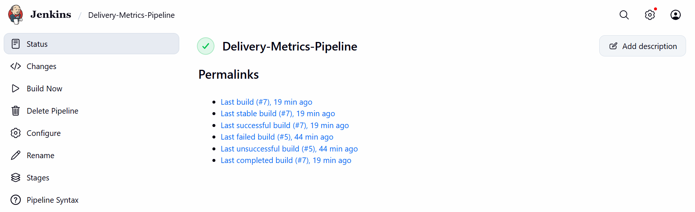

# Real-Time Operations Monitoring and Alerting

## 1. Objective

To build a delivery-service monitoring application for ZAPPTTO using
Python, Prometheus, Grafana, Docker, and Jenkins. The application
simulates delivery metrics, Prometheus collects them, Grafana visualizes
them, and alert rules identify operational issues.

## 2. Tools and Packages

- Windows 11 with PowerShell
- Docker Desktop
- Python 3.10 or higher
- `prometheus-client`
- Prometheus
- Grafana
- Jenkins

Install the Python package if running the application directly:

```text
pip install prometheus-client
```

## 3. Project Structure

Project directory:

```text
6-Grafana Real-Time Monitoring/
├── delivery_metrics.py
├── Dockerfile
├── prometheus.yml
├── alert_rules.yml
├── Jenkinsfile
├── prometheus-ci.yml
├── grafana-datasource.json
├── grafana-provisioning/
└── screenshots/
    ├── 1.png
    ├── 2.png
    ├── 3.png
    └── 4.png
```

The exercise refers to the alert file as `alerts_rules.yml` in the
directory overview and `alert_rules.yml` in the configuration and
Jenkins steps. This implementation uses `alert_rules.yml`.

## 4. Step 1 --- Write the Python Application

`delivery_metrics.py` simulates delivery activity and exposes metrics on
port `8000` for Prometheus.

The application defines these metrics:

- `total_deliveries` --- total number of deliveries.
- `pending_deliveries` --- number of pending deliveries.
- `on_the_way_deliveries` --- number of deliveries on the way.
- `average_delivery_time` --- delivery-time observations collected
  using a Prometheus `Summary`.

The program generates new delivery values repeatedly and exposes them
through the metrics endpoint:

```text
http://localhost:8000/metrics
```

The `/metrics` endpoint is provided by `prometheus_client` when
`start_http_server()` starts.

## 5. Step 2 --- Configure Prometheus

The `prometheus.yml` file configures Prometheus to scrape the delivery
application and load the alert rules. In Docker, the target address must
be reachable from the Prometheus container; this implementation uses
Docker container networking rather than relying on the Linux-only
`172.17.0.1` example in the handout.

The CI stack uses `prometheus-ci.yml` and scrapes the application at:

```text
delivery_metrics-ci:8000
```

Prometheus is available in the original stack at:

```text
http://localhost:9090
```

To verify the scrape target, open Prometheus and go to **Status →
Targets**. The delivery metrics target should show `UP`.



## 6. Step 2a --- Configure Alert Rules

The `alert_rules.yml` file contains the following rules:

| Alert | Condition | Intended meaning |
| --- | --- | --- |
| `HighPendingDeliveries` | `pending_deliveries > 10` for 15 seconds | Pending deliveries remain above the threshold. |
| `HighAverageDeliveryTime` | `(average_delivery_time_sum / average_delivery_time_count) > 30` | The observed cumulative average delivery time exceeds 30 seconds. |

Both rules were loaded and reported as healthy by the CI Prometheus
instance.

### Alert verification

The CI Prometheus API confirmed that `HighPendingDeliveries` reached the
`firing` state. The observed value was 12, above the configured
threshold of 10.

At the time of the final average-time check, the cumulative average was
approximately `29.82` seconds, below the threshold of 30 seconds.
Therefore, `HighAverageDeliveryTime` was configured but was **not
confirmed firing** during this verification.



## 7. Step 3 --- Set Up Grafana

Grafana is available in the original stack at:

```text
http://localhost:3000
```

The original Grafana dashboard contains the four panels specified in the
exercise:

1. **Total Deliveries** --- `total_deliveries`
2. **Pending Deliveries** --- `pending_deliveries`
3. **On-the-Way Deliveries** --- `on_the_way_deliveries`
4. **Average Delivery Time** ---
   `average_delivery_time_sum / average_delivery_time_count`



The CI Grafana instance's health endpoint returned a healthy database
status. However, the four panels were not independently verified on the
CI Grafana instance.

## 8. Step 5 --- Create the Jenkins Pipeline

Jenkins is available at:

```text
http://localhost:8080
```

The `Jenkinsfile` defines the pipeline used for the delivery-metrics CI
workflow. The Jenkins job is named `Delivery-Metrics-Pipeline` and uses
**Pipeline script** in the Jenkins web interface.

The pipeline build completed successfully. Build `#7` succeeded and
built the image `delivery_metrics:7`.



The CI stack contains:

- `delivery_metrics-ci`
- `prometheus-ci`
- `grafana-ci`
- Docker network `delivery-ci-net`

The nested CI services run inside the Docker-in-Docker environment. The
nested Prometheus and Grafana ports are published within that
environment, but their web interfaces were not confirmed accessible
directly from the Windows browser.

## 9. Step 6 --- Simulate and Verify Alerts

The application continuously generates delivery metrics. The CI
Prometheus target was verified as healthy, and the configured alert
rules were loaded.

Verification results:

- **Prometheus target:** delivery application was `UP`.
- **`HighPendingDeliveries`:** confirmed `firing`.
- **`HighAverageDeliveryTime`:** rule loaded, but not confirmed
  firing; the measured cumulative average was approximately 29.82
  seconds during the check.

These results distinguish successful configuration from alerts that were
actually observed firing. The alert screenshot above shows only
`HighPendingDeliveries` firing; it does not show `HighAverageDeliveryTime`
firing.

## 10. Minimum Screenshots for the Lab Record

The available screenshots are included above and mapped as follows:

1. **Jenkins successful build** --- `screenshots/1.png`; shows
   `Delivery-Metrics-Pipeline` and successful build `#7`.
2. **Grafana dashboard** --- `screenshots/2.png`; shows all four
   required delivery-metric panels.
3. **Prometheus Targets** --- `screenshots/3.png`; shows the delivery
   application target as `UP`.
4. **Prometheus alert** --- `screenshots/4.png`; shows
   `HighPendingDeliveries` in the `firing` state.

Do not use a screenshot to claim that `HighAverageDeliveryTime` fired,
because that was not observed.

## 11. Result

The delivery metrics application, Prometheus scraping, alert-rule
configuration, Grafana dashboard, and Jenkins pipeline were implemented
and tested to the extent recorded above. The Jenkins build succeeded,
the CI Prometheus target was healthy, and `HighPendingDeliveries` was
observed firing. `HighAverageDeliveryTime` was configured but was not
observed firing during the final check.
