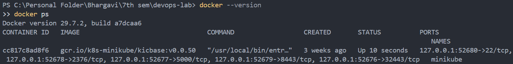
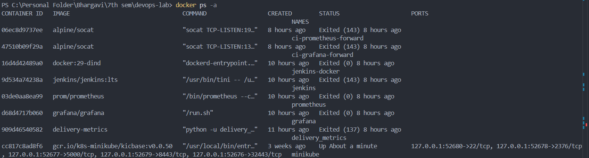
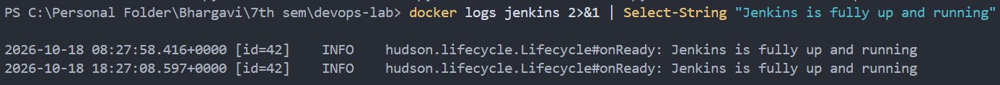
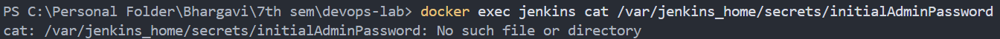
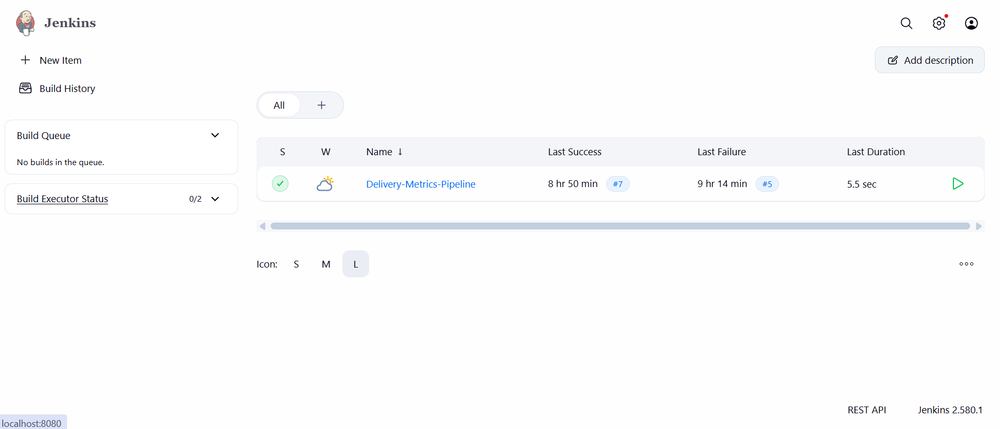

# Introduction to Continuous Integration (CI) and Jenkins Installation

## Objective

Understand the fundamentals of Continuous Integration (CI), learn about
CI tools, and run Jenkins locally using Docker.

## 1. Introduction to Continuous Integration (CI)

Continuous Integration is a development practice in which developers
frequently integrate code changes into a shared repository. Automated
builds and tests help detect integration problems early and provide quick
feedback.

### Key features of CI

1. **Frequent code integration:** Developers commit changes to a shared
   repository regularly.
2. **Automated builds:** A CI server can build the application after a
   change is detected.
3. **Automated testing:** Tests run to check that code changes have not
   broken existing functionality.
4. **Immediate feedback:** Build and test results help developers
   identify problems quickly.

### Benefits of CI

- Detects bugs and integration issues early.
- Improves collaboration across a team.
- Speeds up development feedback cycles.
- Helps maintain code quality by running tests repeatedly.

### Typical CI workflow

1. A developer pushes code to a version-control repository such as Git.
2. A CI server detects the change or receives a trigger.
3. The server builds the code and resolves dependencies.
4. Automated tests run.
5. The server reports success or failure to the team.

### Examples of CI/CD tools

- GitLab CI/CD
- CircleCI
- Travis CI
- Bamboo
- TeamCity
- Azure Pipelines
- GitHub Actions
- Spinnaker (primarily continuous delivery)
- Buildkite
- Drone
- Jenkins

## 2. Introduction to Jenkins

Jenkins is an open-source automation server used to automate software
build, test, and delivery tasks. Plugins extend Jenkins to integrate
with source-control systems, build tools, testing frameworks, container
platforms, and deployment environments.

### Key Jenkins concepts

- **Job/Project:** A task configured to run in Jenkins.
- **Build:** One execution of a job or pipeline.
- **Pipeline:** A sequence of steps for building, testing, and optionally
  deploying software.
- **Plugins:** Extensions that add integrations and features.
- **Nodes/Agents:** Machines that execute Jenkins work. The controller
  coordinates jobs.

## 3. Jenkins installation using Docker

### Step 1: Verify Docker

Run these commands in PowerShell:

```powershell
docker --version
docker ps
```

Docker version observed during this exercise:

```text
Docker version 29.7.2, build a7dcaa6
```

Docker initially returned an error because the Docker Desktop Linux
engine was not available. After starting Docker Desktop, `docker ps`
worked and showed the existing `minikube` container.



### Step 2: Start Jenkins

The exercise's standard command is:

```powershell
docker run -d --name jenkins -p 8080:8080 -p 50000:50000 jenkins/jenkins:lts
```

In this environment, Docker reported that the container name `jenkins`
was already in use. Inspection with `docker ps -a` showed an existing
Jenkins container that had exited. To preserve its existing
configuration, the existing container was restarted instead of deleting
or recreating it:

```powershell
docker ps -a
docker start jenkins
```



The `docker start` command returned:

```text
jenkins
```

Port mappings for the running container were verified using
`docker ps`. The Jenkins container showed status `Up` and these port
mappings:

```text
0.0.0.0:8080->8080/tcp
[::]:8080->8080/tcp
0.0.0.0:50000->50000/tcp
[::]:50000->50000/tcp
```

There is no separate screenshot of `docker start jenkins` and the
subsequent port mappings in the available evidence.

### Step 3: Check Jenkins startup logs

Run:

```powershell
docker logs --tail 80 jenkins
```

The logs showed that Jenkins initialized successfully, including this
message:

```text
Jenkins is fully up and running
```



### Step 4: Initial administrator password and existing setup

The command in a fresh Jenkins installation is:

```powershell
docker exec jenkins cat /var/jenkins_home/secrets/initialAdminPassword
```

In this exercise, the file was not present. The existing Jenkins home
already contained user configuration and installed plugins, indicating
that the container had been set up previously. The existing user
directory was found under `/var/jenkins_home/users/`.

Because the initial setup had already been completed, the initial
administrator password could not be retrieved from that file. The
existing account was used to sign in. No container or Jenkins
configuration was deleted.



### Step 5: Access Jenkins in a browser

Open [http://localhost:8080/](http://localhost:8080/).

The Jenkins login page appeared. Signing in with the existing account
succeeded, and the Jenkins dashboard was reached.



### Step 6: Verify the installation

The installation was verified by confirming:

- The Jenkins container was running.
- Port `8080` was mapped to the host.
- Jenkins logs reported that it was fully up and running.
- The Jenkins web interface opened at `http://localhost:8080/`.
- Login succeeded and the dashboard was accessible.

## 4. Screenshot map

Screenshots are stored in the `screenshot` folder next to this README.
The numbered files map to the exercise as follows:

| File | Evidence |
| --- | --- |
| `screenshot/1.png` | Docker version and successful `docker ps` showing `minikube`. |
| `screenshot/2.png` | `docker ps -a` showing the existing exited Jenkins container. |
| `screenshot/3.png` | Exact duplicate of `screenshot/2.png`; it adds no separate evidence. |
| `screenshot/4.png` | Jenkins startup log message confirming Jenkins is fully up and running. |
| `screenshot/5.png` | Initial administrator password file check showing that the file is absent. |
| `screenshot/6.png` | Jenkins dashboard after successful login. |

No screenshot contains a password or token. The available screenshots do
not include the `docker start jenkins` result or the running-container
port mapping output, so those steps are documented above without an
image.

## Result

Jenkins was successfully started in Docker and accessed through
`http://localhost:8080/`. The existing container and account were
reused, the startup logs confirmed that Jenkins was fully running, and
login to the Jenkins dashboard succeeded.
