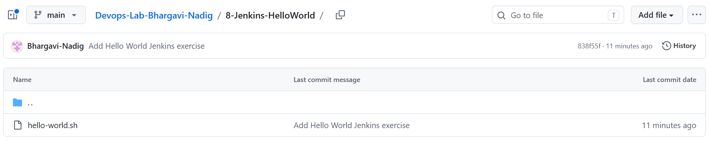
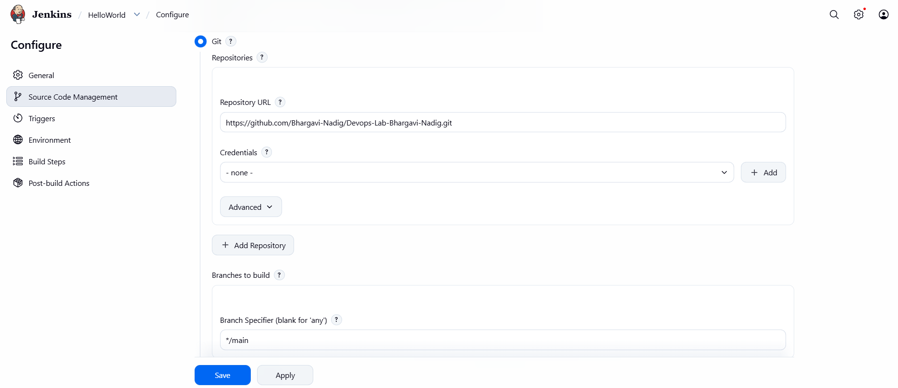
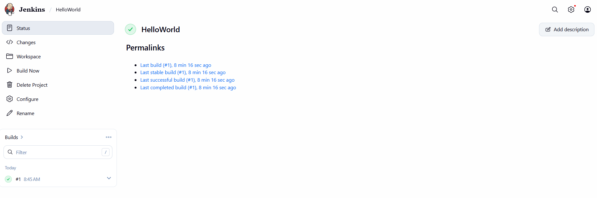

# Creating a Hello World Jenkins Job

## Objective

Create and run a Jenkins Freestyle project that retrieves a shell script
from GitHub, executes it, and displays its output in the Jenkins Console
Output.

## Prerequisites

- Git installed locally.
- A GitHub account and repository.
- Docker Desktop installed and running.
- Jenkins running in a Docker container.
- Access to the Jenkins dashboard.

## Step 1: Use the existing GitHub repository

The existing `Devops-Lab-Bhargavi-Nadig` repository was reused to keep
the DevOps exercises together; a separate repository was not created.

Repository URL:

```text
https://github.com/Bhargavi-Nadig/Devops-Lab-Bhargavi-Nadig
```

The repository is public, so Jenkins does not need credentials to clone
it. A personal access token is not required for Jenkins to clone a
public repository. If using HTTPS to push changes from a local Git
client, authenticate with a token when prompted and keep it private.

## Step 2: Create the shell script

From the repository root, create the exercise folder and script:

```powershell
New-Item -ItemType Directory -Force 8-Jenkins-HelloWorld
Set-Location 8-Jenkins-HelloWorld
notepad hello-world.sh
```

Add the following content to `hello-world.sh`:

```bash
#!/bin/bash
echo "Hello, Jenkins!"
```

Save the file, then verify its contents:

```powershell
Get-Content hello-world.sh
```

Expected output:

```text
#!/bin/bash
echo "Hello, Jenkins!"
```

The Jenkins build step invokes the file with `sh`, so the executable bit
does not need to be set.

## Step 3: Commit and push the script

Return to the repository root, stage only this exercise, and commit it:

```powershell
Set-Location ..
git add 8-Jenkins-HelloWorld/
git status
git commit -m "Add Hello World Jenkins exercise"
git push
```

Confirm that `8-Jenkins-HelloWorld/hello-world.sh` is present in the
GitHub repository:



## Step 4: Start Jenkins

Ensure Docker Desktop is running, then start the existing Jenkins
container and verify that it is running:

```powershell
docker start jenkins
docker ps
```

Open [http://localhost:8080/](http://localhost:8080/) and sign in using
the existing Jenkins credentials.

## Step 5: Create the Jenkins job

1. On the Jenkins dashboard, select **New Item**.
2. Enter `HelloWorld` as the item name and select **Freestyle project**.
3. Select **OK**.
4. In **General**, set the description to `Hello World! Jenkins job.`

## Step 6: Configure source code management

1. Under **Source Code Management**, select **Git**.
2. Set **Repository URL** to:

   ```text
   https://github.com/Bhargavi-Nadig/Devops-Lab-Bhargavi-Nadig.git
   ```

3. Leave **Credentials** set to none because the repository is public.
4. Under **Branches to build**, set the branch specifier to `*/main`.



Jenkins checks out the repository into the job's workspace.

## Step 7: Configure the build step

1. Under **Build Steps**, select **Add build step** and choose
   **Execute shell**.
2. Enter this command:

   ```sh
   sh 8-Jenkins-HelloWorld/hello-world.sh
   ```

3. Select **Save**.

## Step 8: Run the job and check its output

1. Open the `HelloWorld` job and select **Build Now**.
2. Wait for the build to complete.
3. Under **Build History**, open the latest build and select
   **Console Output**.

The console should include:

```text
+ sh 8-Jenkins-HelloWorld/hello-world.sh
+ echo 'Hello, Jenkins!'
Hello, Jenkins!
Finished: SUCCESS
```

The temporary script name, timestamps, and other Jenkins log details
may differ. The available screenshot shows the job's successful status;
the expected console output is shown above.



## Screenshot map

| Screenshot | Evidence |
| --- | --- |
| `screenshots/1.png` | GitHub repository listing `hello-world.sh` in the exercise folder. |
| `screenshots/2.png` | Jenkins Git source configuration, including repository URL, no credentials, and `*/main`. |
| `screenshots/3.png` | `HelloWorld` job page showing a successful build. |

## Result

The `HelloWorld` Freestyle job checks out the public GitHub repository,
runs `8-Jenkins-HelloWorld/hello-world.sh`, and prints `Hello, Jenkins!`
in Console Output. The build completes with status **SUCCESS**.

## Conclusion

This exercise demonstrates how a Jenkins Freestyle job can retrieve
source code from GitHub, execute a shell script, and report build output.
The same workflow can be extended to run tests, build applications, and
support CI/CD pipelines.
