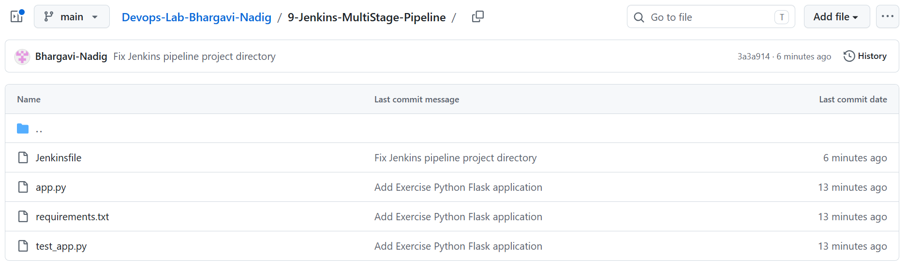
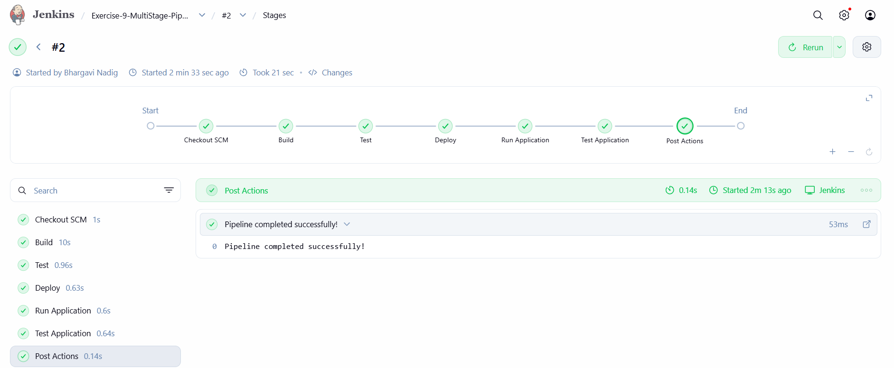
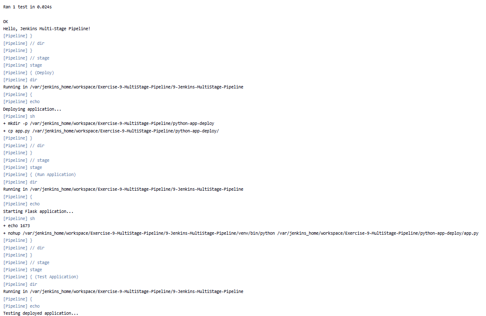

# Exercise 9: Jenkins Multi-Stage Pipeline for a Python Flask Application

## Objective

Build, test, deploy, start, and verify a Python Flask application using a
declarative Jenkins pipeline.

## Tools and technologies

- Jenkins running in Docker
- Git and GitHub
- Python 3 and `venv`
- Flask
- Python `unittest`
- PowerShell

## Project files

| File | Purpose |
| --- | --- |
| `app.py` | Flask app that serves the exercise message on `/`. |
| `requirements.txt` | Pins Flask and Werkzeug dependencies. |
| `test_app.py` | Unit test for the homepage response. |
| `Jenkinsfile` | Declarative pipeline for building, testing, deploying, and checking the app. |
| `screenshots/` | Screenshots documenting the repository and successful Jenkins run. |

## 1. Prepare Jenkins

Start the existing Jenkins container and check that Git is available:

```powershell
docker ps -a
docker start jenkins
docker exec jenkins git --version
```

The Jenkins container used for this exercise did not initially have Python
and pip installed. Install them in the container as root:

```powershell
docker exec -u root -it jenkins bash
```

Then, inside the container:

```bash
apt-get update
apt-get install -y python3 python3-pip python3-venv
python3 --version
python3 -m pip --version
exit
```

The pipeline uses `sh` and Linux virtual-environment paths, so its Jenkins
agent must be a Linux environment with Python 3, `venv`, and `curl`
available.

## 2. Flask application and test

`app.py` creates a Flask app that listens on `0.0.0.0:5000` and returns
`Hello, Jenkins Multi-Stage Pipeline!` at `/`. Dependencies are listed in
`requirements.txt`. The `unittest` test client in `test_app.py` checks the
homepage status code and exact response text.

## 3. Put the exercise in GitHub

This exercise is part of the existing
[Devops-Lab-Bhargavi-Nadig repository](https://github.com/Bhargavi-Nadig/Devops-Lab-Bhargavi-Nadig).
If you are using an existing local repository, first check that it is
connected to the intended remote:

```powershell
git status
git remote -v
```

Add and push only the exercise files from the repository root:

```powershell
git add 9-Jenkins-MultiStage-Pipeline/
git commit -m "Add Exercise 9 Jenkins multi-stage pipeline"
git push
```

Do not run `git init` or add another remote if the local repository is
already configured. If starting from a new local project, create a GitHub
repository first, initialize Git in the local repository root, and add
that repository as `origin` before pushing.

Confirm the exercise files are present in GitHub:



## 4. Jenkins pipeline

The `Jenkinsfile` is stored inside the exercise directory, so Jenkins must
run the build steps in `9-Jenkins-MultiStage-Pipeline`. Its five
application stages are:

1. **Build** — Create a Python virtual environment and install the pinned
   dependencies.
2. **Test** — Run the unit tests with `unittest`.
3. **Deploy** — Copy `app.py` to `python-app-deploy` in the Jenkins
   workspace. This is a mock deployment, not a production server.
4. **Run Application** — Start the deployed app in the background.
5. **Test Application** — Request `http://127.0.0.1:5000/` and fail the
   stage if the expected HTTP response is not available.

Jenkins also checks out the repository before these stages. The
`Jenkinsfile` has a post-build message for success or failure.

## 5. Configure a Jenkins Pipeline job

1. Open [Jenkins](http://localhost:8080/) and select **New Item**.
2. Enter `Exercise-9-MultiStage-Pipeline`, select **Pipeline**, and choose
   **OK**.
3. Under **Pipeline**, set **Definition** to **Pipeline script from SCM**.
4. Select **Git** and enter the repository URL:

   ```text
   https://github.com/Bhargavi-Nadig/Devops-Lab-Bhargavi-Nadig.git
   ```

5. Set the branch specifier to `*/main`. Leave credentials empty for this
   public repository.
6. Set **Script Path** to:

   ```text
   9-Jenkins-MultiStage-Pipeline/Jenkinsfile
   ```

7. Save the job, select **Build Now**, and open the build's stage view or
   Console Output.

The stage view should show the pipeline stages completing successfully:



## 6. Results

The successful run installed dependencies, passed the unit test, copied
the application to the mock deployment directory, started Flask, and
verified its HTTP response. The console output included:

```text
Ran 1 test
OK
Hello, Jenkins Multi-Stage Pipeline!
Pipeline completed successfully!
Finished: SUCCESS
```

The Console Output shows the test result, expected Flask response, and
the deployment and application verification steps:



The first run failed because Jenkins executed commands from the repository
root and could not find `requirements.txt`. Running the build commands in
the exercise directory fixed the workspace-path issue.

## Conclusion

This exercise demonstrates a Jenkins multi-stage CI/CD workflow for a
Flask application: dependency installation, automated unit testing, a
workspace-based mock deployment, application startup, and an HTTP
smoke test. The mock deployment directory is inside the Jenkins
workspace; the pipeline does not deploy to a separate production server.
